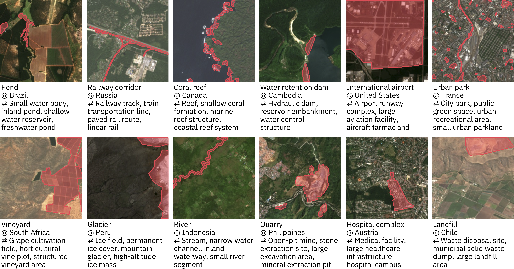

[](https://arxiv.org/)
[](https://huggingface.co/ibm-esa-geospatial/TerraMesh-Masks)
[](https://huggingface.co/ibm-esa-geospatial/TerraMesh-Masks-Eval)

# TerraMesh-Masks
 
TerraMesh-Masks is a dataset for open-vocabulary segmentation of satellite imagery. This repository provides data loading code for the datasets.
You find the [training dataset](https://huggingface.co/ibm-esa-geospatial/TerraMesh-Masks) and [evaluation benchmark](https://huggingface.co/ibm-esa-geospatial/TerraMesh-Masks-Eval) on Hugging Face.

## Examples

TerraMesh-Masks reuses samples from [TerraMesh](https://huggingface.co/ibm-esa-geospatial/TerraMesh) and adds binary masks with captions for open-vocabulary segmentation. Examples from the human-verified evaluation subset: 




## Usage

Install requirements with `pip install -r requirements.txt`. For development, you can stream data directly from Hugging Face.
We provide data loading code in [terramesh](terramesh) with examples in [playground_terramesh_masks_loader.ipynb](playground_terramesh_masks_loader.ipynb) and [playground_eval_loader.ipynb](playground_eval_loader.ipynb).


Load training samples with:
```python
from torch.utils.data import DataLoader
from terramesh.masks_dataset import build_terramesh_masks_dataset

dataset = build_terramesh_masks_dataset(
    urls="https://huggingface.co/datasets/ibm-esa-geospatial/TerraMesh-Masks/resolve/main/val/[BINARY_MASK,S2RGB]/majortom_shard_000001.tar",
    batch_size=4,
    shardshuffle=100,  # Shuffle data
)

dataloader  = DataLoader(dataset, batch_size=None)
batch = next(iter(dataloader))
```

Load from samples from the evaluation dataset:
```python
from torch.utils.data import DataLoader
from terramesh.masks_eval_dataset import build_eval_dataset

dataset = build_eval_dataset(
    path="https://huggingface.co/datasets/ibm-esa-geospatial/TerraMesh-Masks-Eval/resolve/main/test/", # Default
    modalities=["S2RGB", "BINARY_MASK"], # Select from ["S2L2A", "S2L1C", "S2RGB", "S1_merged", "DEM", "BINARY_MASK"]
    batch_size=4,
)
dataloader  = DataLoader(dataset, batch_size=None)
batch = next(iter(dataloader))
```

We combined the Sentinel-1 GRD and RTC data in TerraMesh into a shared archive `S1_merged.tar` to makes data handling easier. However, this leads to some batches having `S1RTC` and others `S1GRD` keys. Therefore, use `batch_size=1` when loading Sentinel-1 data. 

## Download evaluation data

You can download the dataset with the Hugging Face CLI tool

```shell
hf download ibm-esa-geospatial/TerraMesh-Masks-Eval --repo-type dataset --local-dir data/TerraMesh
```

This results in the following data structure:
```text
TerraMesh
├── test
│   ├── BINARY_MASK.tar
│   ├── DEM.tar
│   ├── S1_merged.tar
│   ├── S2L1C.tar
│   ├── S2L2A.tar
│   └── S2RGB.tar
└── test_metadata.parquet
```

Different from TerraMesh, the samples are now stored as tif files which makes reviewing samples easier. You can also untar the archives and load them without using `webdataset`.

## Download training data

Please note that the full dataset requires 17TB or storage and is provided by at https://huggingface.co/ibm-esa-geospatial/TerraMesh.

```shell
# Download image data
hf download ibm-esa-geospatial/TerraMesh --repo-type dataset --local-dir data/TerraMesh

# Download binary mask data
hf download ibm-esa-geospatial/TerraMesh-Masks --repo-type dataset --local-dir data/TerraMesh
```

If you like to download only a subset of the data, you can specify it with `--include`.
```shell
# Only download a single modality (e.g., S2L2A)
hf download ibm-esa-geospatial/TerraMesh --repo-type dataset --include "*/S2L2A/*" --local-dir data/TerraMesh

# Only download val data from TerraMesh-Masks
hf download ibm-esa-geospatial/TerraMesh-Masks --repo-type dataset --include "val/*" --local-dir data/TerraMesh
```

## Citation

Preprint for TerraMesh-Masks is coming soon!

TerraMesh:

```bibtex
@article{blumenstiel2025terramesh,
  title={Terramesh: A planetary mosaic of multimodal earth observation data},
  author={Blumenstiel, Benedikt and Fraccaro, Paolo and Marsocci, Valerio and Jakubik, Johannes and Maurogiovanni, Stefano and Czerkawski, Mikolaj and Sedona, Rocco and Cavallaro, Gabriele and Brunschwiler, Thomas and Bernabe-Moreno, Juan and others},
  journal={Proceedings of the IEEE/CVF Conference on Computer Vision and Pattern Recognition (CVPR) Workshops},
  year={2025},
}
```

## Licenses

This code is released under Apache 2.0.

The mask annotations are released under ODbL, following the OpenStreetMap license.

The image data is released under CC-BY-SA 4.0. 

## Acknowledgements

TerraMesh is part of the **FAST‑EO** project funded by the European Space Agency Φ‑Lab.

The binary annotations are based on the base layer provided by [Overture Maps](https://overturemaps.org/) and from [OpenStreetMap](https://www.openstreetmap.org/copyright) tags.

The image data in TerraMesh-Masks-Eval is sourced from various sources:

The satellite images (S2L1C, S2L2A, S1GRD, S1RTC) are sourced from the [SSL4EO‑S12 v1.1](https://huggingface.co/datasets/embed2scale/SSL4EO-S12-v1.1) (CC-BY-4.0) and [MajorTOM‑Core](https://huggingface.co/Major-TOM) (CC-BY-SA-4.0) datasets.

The LULC data is provided by [ESRI, Impact Observatory, and Microsoft](https://planetarycomputer.microsoft.com/dataset/io-lulc-annual-v02) (CC-BY-4.0).

The DEM data is produced using [Copernicus WorldDEM-30](https://dataspace.copernicus.eu/explore-data/data-collections/copernicus-contributing-missions/collections-description/COP-DEM) © DLR e.V. 2010-2014 and © Airbus Defence and Space GmbH 2014-2018 provided under COPERNICUS by the European Union and ESA; all rights reserved


